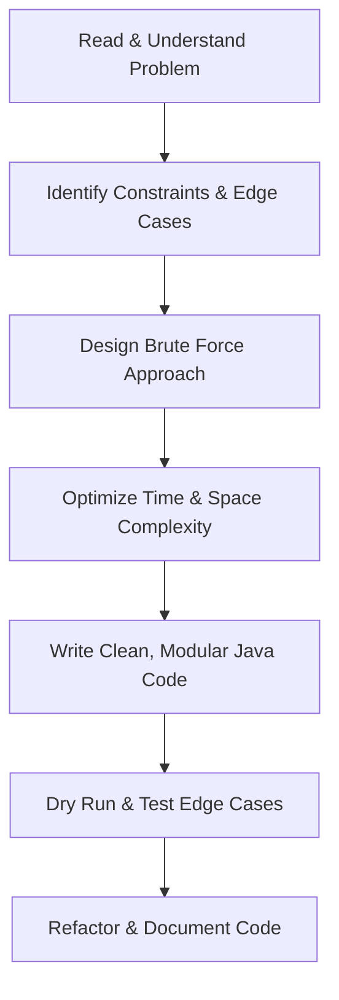

# ☕ Java Data Structures & Algorithms Practice


> Welcome to my personal playground for mastering **Data Structures & Algorithms (DSA)** using Java. This repository tracks my daily practice, problem-solving journey, and implementation of core computer science concepts.

---

## 📊 Progress Dashboard

| Topic Category | Topics Covered | Solved | Progress | Status |
| :--- | :--- | :---: | :--- | :---: |
| **Foundations** | Java Basics, Time/Space Complexity | 3 | `[████████░░]` 80% | 🟡 In Progress |
| **Linear Data Structures** | Arrays, Strings, Linked Lists | 0 | `[░░░░░░░░░░]` 0% | 🔴 Not Started |
| **Core Structures** | Stacks, Queues, Hash Tables | 0 | `[░░░░░░░░░░]` 0% | 🔴 Not Started |
| **Non-Linear Structures** | Trees, BSTs, Graphs | 0 | `[░░░░░░░░░░]` 0% | 🔴 Not Started |
| **Algorithms** | Sorting, Searching, Greedy | 0 | `[░░░░░░░░░░]` 0% | 🔴 Not Started |
| **Advanced Topics** | DP, Backtracking, Bit Manipulation | 0 | `[░░░░░░░░░░]` 0% | 🔴 Not Started |

---

## 🛠️ Problem-Solving Workflow

Below is the structured methodology I follow for every problem to ensure deep understanding and optimal solutions:



---

## 🗺️ DSA Learning Roadmap

### 📦 1. Foundations & Math
- [x] Basic Syntax & Operators (e.g., [practical_3.java](file:///c:/Daily%20Practice%20Repo/Day_1/practical_3.java))
- [x] Variables, Data Types & Formatting (e.g., [practical_2.java](file:///c:/Daily%20Practice%20Repo/Day_1/practical_2.java))
- [] Time and Space Complexity Analysis (Big O)
- [ ] Basic Mathematics & Number Theory (GCD, Prime Numbers)

### ⛓️ 2. Linear Data Structures
- [ ] **Arrays & Matrices**
  - [ ] Multi-dimensional Arrays
  - [ ] Two-pointer & Sliding Window technique
  - [ ] Prefix Sum & Kadane's Algorithm
- [ ] **Strings**
  - [ ] String Manipulation (e.g., [Practice_1.java](file:///c:/Daily%20Practice%20Repo/Day_1/Practice_1.java))
  - [ ] Pattern Matching Algorithms (KMP, Rabin-Karp)
- [ ] **Linked Lists**
  - [ ] Singly Linked List
  - [ ] Doubly & Circular Linked List
  - [ ] Cycle Detection & Pointer manipulation

### 📚 3. Hierarchical & Core Structures
- [ ] **Stacks & Queues**
  - [ ] Implementation using Arrays & Linked Lists
  - [ ] Monotonic Stack/Queue problems
  - [ ] Deque & Priority Queue
- [ ] **Hashing**
  - [ ] HashMaps & HashSets
  - [ ] Collision resolution techniques

### 🌲 4. Non-Linear Data Structures
- [ ] **Trees & Binary Search Trees (BST)**
  - [ ] Tree Traversals (Inorder, Preorder, Postorder, Level-order)
  - [ ] Height, Diameter, and View of Trees
  - [ ] Balanced Trees (AVL, Red-Black Trees)
- [ ] **Graphs**
  - [ ] BFS & DFS Traversals
  - [ ] Shortest Path Algorithms (Dijkstra, Bellman-Ford, Floyd-Warshall)
  - [ ] Minimum Spanning Tree (Prim's & Kruskal's)
  - [ ] Topological Sorting & Cycle Detection

### ⚙️ 5. Advanced Algorithms & Paradigms
- [ ] **Searching & Sorting**
  - [ ] Binary Search (Standard and Search Space)
  - [ ] Bubble, Insertion, Selection, Merge, Quick, and Heap Sort
- [ ] **Recursion & Backtracking**
  - [ ] Subset generation, Permutations
  - [ ] N-Queens, Sudoku Solver
- [ ] **Dynamic Programming (DP)**
  - [ ] 1D & 2D Grid DP
  - [ ] Knapsack, LIS, LCS variations
- [ ] **Bit Manipulation & Greedy Algorithms**

---

## 🚀 How to Run the Code

Since this repository uses Java packages structured by day (e.g., `Day_1`), follow these commands to compile and run files from the root directory:

### 1. Compile a Java file
```bash
javac Day_1/practical_2.java
```

### 2. Run the compiled class
```bash
java Day_1.practical_2
```

> [!TIP]
> If you are using VS Code, you can also use the **Code Runner** extension. Simply open the file, right-click, and choose **Run Code** (or press `Ctrl` + `Alt` + `N`).

---

## 🔗 Useful Resources
- 🚀 [LeetCode](https://leetcode.com/) - Problem Solving Platform
- 📖 [GeeksforGeeks DSA](https://www.geeksforgeeks.org/data-structures/) - Detailed Tutorials
- 🧮 [NeetCode Roadmap](https://neetcode.io/roadmap) - Interactive DSA Roadmap
- 📝 [Java Documentation](https://docs.oracle.com/en/java/) - Official Java API docs